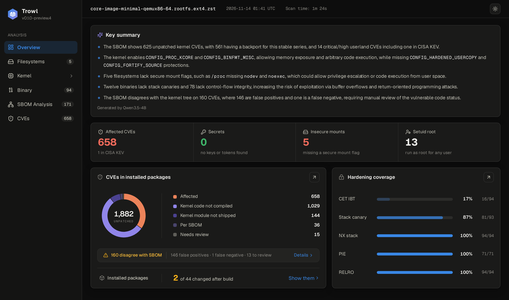

<p align="center">
  <picture>
    <source media="(prefers-color-scheme: dark)" srcset="assets/trowl-logo-dark.svg">
    
  </picture>
</p>

Trowl is a post-build security scanner for embedded Linux images.

It unpacks the image to detect hardening gaps, misconfigurations and known CVEs across kernel and userland. It can also analyse an SBOM when available.

Given a source tree (`--kernel-tree`), it further assigns VEX statuses to kernel CVEs and surfaces disagreements with the SBOM.

<p align="center">
  
</p>

## What it checks
- Privileged binaries and compiler hardening (e.g., NX, CFI, PIE, stack protection)
- Kernel hardening (configurations, unsigned modules)
- Filesystem security
- Secrets and private keys
- SBOM dependencies and image discrepancies
- Known CVEs, fixes, available kernel backports
- SBOM VEX disagreements (e.g. code compiled but `.ko` module not shipped)

## Currently supported
- **Distro:** Yocto
- **Filesystems:** ext2/3/4, squashfs, tar, or an unpacked directory.
- **Disk images:** `.wic` and other MBR/GPT images (ext or squashfs partitions). Scans the detected rootfs only.
- **Compression:** zstd, xz, gzip, bzip2.
- **SBOMs:** SPDX 3.0 JSON-LD from Yocto, including `sbom-cve-check` output, and SPDX 2.2 from Yocto's `create-spdx-2.2` (the scarthgap default): pass `IMAGE.spdx.tar.zst` or a directory of its documents.

### Local LLM (experimental)

Trowl uses local LLM to generate impact summaries. Model weights are downloaded from Hugging Face.

Supported models (licensed under Apache 2.0):

- [`qwen3-4b`](https://huggingface.co/Qwen/Qwen3-4B-GGUF)
- [`qwen3.5-4b`](https://huggingface.co/unsloth/Qwen3.5-4B-GGUF) (default and preferred)
- [`qwen3.5-9b`](https://huggingface.co/unsloth/Qwen3.5-9B-GGUF)

## Quick start (Docker)

Assuming `/path/to/input` contains the scan targets (e.g. image, SBOM and kernel config):

```sh
docker run --rm -t \
  --user "$(id -u):$(id -g)" \
  -v /path/to/input:/in:ro \
  -v /path/to/output:/out \
  -v /path/to/kernel-source:/tree:ro \
  ghcr.io/corefense-security/trowl:$REF \
  scan /in/rootfs.ext4 \
    --sbom /in/sbom.spdx.json \
    --kernel-tree /tree \
    --kernel-config /in/kernel.config \
    -o /out/report
```
> [!TIP]
> Create `~/.cache/trowl` and pass `-v ~/.cache/trowl:/cache/trowl` to reuse downloaded CVE feeds and model weights.

> [!NOTE]
> `--kernel-tree`, `--kernel-config` and `--sbom` are optional, but enrich Trowl's VEX analysis.

Reports are saved under `/path/to/output/report/` (`index.html` and `report.json`). HTML reports can be viewed locally or via static hosting (GitHub Pages, Cloudflare Pages, S3).

For example:

```sh
python3 -m http.server 8765 --directory /path/to/output/report
```

## Install

On Debian or Ubuntu (x86-64 or arm64):

```sh
# --with-llm is optional (Trowl skips AI summary)
curl -fsSL https://raw.githubusercontent.com/corefense-security/trowl/$REF/install.sh | bash -s -- --ref "$REF" --with-llm

# Scan image
trowl scan rootfs.ext4 --sbom /path/to/sbom.spdx.json \
      --kernel-config kernel.config \
      --kernel-tree /path/to/kernel-source -o report

# View report
trowl view report
```
Run `trowl scan --help` for all options.

> [!IMPORTANT]
> Until the first stable release, set `REF` to the latest preview tag in both the Docker and installer steps.


## External data

Trowl queries and caches relevant external resources:

- NVD, OSV and kernel CNA records
- CISA KEV, EPSS
- Model weights from Hugging Face

## Roadmap
- CI integration
- Build diffing for security regression
- License scanning
- Terminal reporting
- SBOM/VEX report generation
- More targets (Android, OpenWrt) and filesystems (EROFS, btrfs)

## Community

Trowl is under active development, and some features do not yet have automated tests. Test coverage will be expanded as the project matures.

Contributions and feedback are welcome. Please follow our [Code of Conduct](CODE_OF_CONDUCT.md).

- [Open an issue](https://github.com/corefense-security/trowl/issues) for bugs or feature requests.
- Include reproduction steps and sanitized examples.
- Submit pull requests with a clear description of the changes.

## License

[Apache License 2.0](LICENSE).
