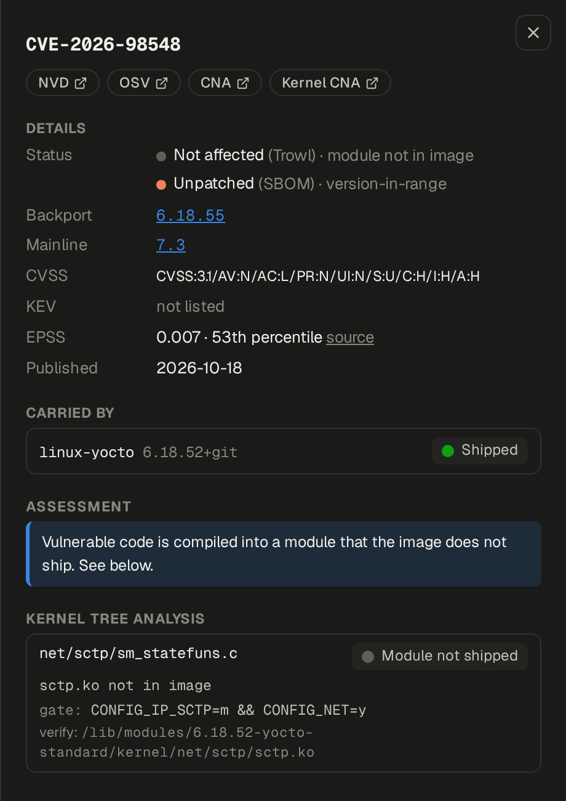
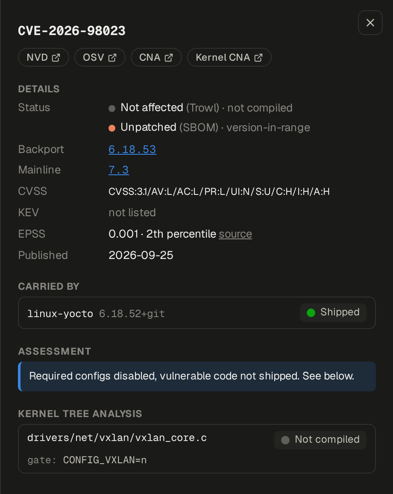

## Where CVEs come from

Trowl matches components against CVE data by CPE name and version.

- **NVD** for CVE records, CVSS and CPE ranges
- **Kernel CNA** records for kernel version ranges and the source files each fix touches
- **CISA KEV** for known exploited CVEs
- **EPSS** for exploit probability

Components come from the SBOM when you pass one. If the SBOM already gives a CVE a status, Trowl keeps it. Without an SBOM Trowl reads the opkg, dpkg or rpm database in the image. If there is none, it falls back to version strings in common binaries such as busybox, glibc and openssl.

The table shows each CVE with its status, CVSS, attack vector, whether the component ships and whether it is in KEV. The Fixed in column shows the stable backport when one exists and marks it with **B**.

## Kernel CVEs with `--kernel-tree`

A version match says the kernel release is in a CVE's affected range. It doesn't say whether your build contains the vulnerable code. Most kernel CVEs sit in drivers and protocols that a given config never compiles.

The `--kernel-tree` option makes Trowl look at the source files named in the kernel CNA record. It reads the tree's Makefiles to find the config options that build each file. Then it checks those options against your `.config` and the modules in the image.

| File result | CVE status | VEX justification |
| --- | --- | --- |
| Any file compiled into the kernel or a shipped module | Unpatched | |
| Files only compiled into modules the image doesn't ship | Not affected | `component_not_present` |
| No file compiled by this config | Not affected | `vulnerable_code_not_present` |
| Trowl can't decide | Needs review | |

Trowl never clears a CVE on a guess. Anything it can't decide becomes Needs review. CVEs the SBOM marks as fixed are left alone.

### Example: module not shipped

CVE-2026-98548 is an SCTP bug with a CVSS score of 9.8. The SBOM marks it Unpatched because 6.18.52 falls in its affected range. The config builds SCTP as a module (`CONFIG_IP_SCTP=m`) but the image doesn't ship `sctp.ko`. Trowl clears it and shows the path to check on a device.

### Example: code not compiled

CVE-2026-98023 is in the VXLAN driver. The config has `CONFIG_VXLAN=n`, so the vulnerable file is never built.

## SBOM disagreements

Tools like `sbom-cve-check` write kernel CVE statuses into the SBOM. When Trowl's result differs, the row gets a **≠** mark and the CVE appears under the **SBOM disagreements** filter. The detail panel shows both statuses one above the other.

A disagreement is counted when:

- the SBOM says Unpatched and Trowl says Not affected, or
- the SBOM says Not affected and Trowl finds the code compiled or can't tell.

In the scan above 160 kernel CVE statuses in the SBOM disagree with what the image and config show. Trowl clears 146 of them.

## Requirements

- A full kernel `.config` from the image or `--kernel-config` (a defconfig is not enough)
- The kernel source at the same release as the image's kernel
- The image's `/lib/modules/<release>` folder to see which modules ship

If you leave out `--kernel-tree`, kernel CVEs stay plain version matches and the detail panel says so.
