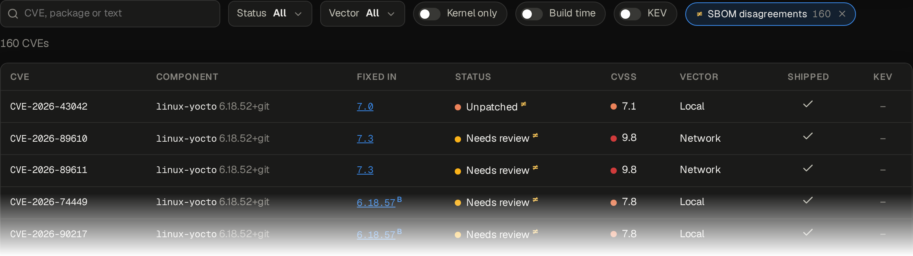

import KernelVexFlow from '../../../components/KernelVexFlow.astro';

Trowl matches userland components and the kernel against CVE version ranges. For kernel CVEs, `--kernel-tree` also checks whether your build includes the affected code.

## Data sources

<div style={{ overflowX: 'auto' }}>

| Source | Used for | Fetched from |
| --- | --- | --- |
| `NVD` | CVE records, CVSS and CPE ranges | [NVD JSON feed mirror](https://github.com/fkie-cad/nvd-json-data-feeds) with one file per year |
| `Kernel CNA` | Kernel version ranges, stable backports and affected source files | Kernel CNA records in the [NVD feed mirror](https://github.com/fkie-cad/nvd-json-data-feeds) |
| `CISA KEV` | Known exploited CVEs | [cisagov/kev-data](https://github.com/cisagov/kev-data) with [cisa.gov](https://www.cisa.gov/sites/default/files/feeds/known_exploited_vulnerabilities.json) as a fallback |
| `EPSS` | Exploit probability | [Daily EPSS score file](https://epss.empiricalsecurity.com/epss_scores-current.csv.gz) |

</div>

### Links

The detail panel links to NVD, [OSV](https://osv.dev/) and [cve.org](https://www.cve.org/). Kernel CVEs also link to [vulns.git](https://git.kernel.org/pub/scm/linux/security/vulns.git/). These references do not supply matching data.

### Caching

Trowl caches downloaded data and link-check results, usually in `~/.cache/trowl`. Online scans refresh stale data and use an existing cached copy if a download fails. 

See [Network and cache](../../reference/architecture/#network-and-cache) for details.

## Userland CVEs

With `--sbom`, Trowl reads components and their CPEs from the SBOM to perform version matching. See [SBOM analysis](../sbom/#sbom-for-cve-analysis).

Without an SBOM, Trowl tries package databases first and falls back to fingerprints.

#### Package database

Trowl uses source package names where available and removes epochs and packaging revisions to match upstream releases. For example, `1:2.36-r0` becomes `2.36`.

Databases are checked in this order:

<div style={{ overflowX: 'auto' }}>

| Database | Location |
| --- | --- |
| `opkg` | `/var/lib/opkg/status` or `/usr/lib/opkg/status` |
| `dpkg` | `/var/lib/dpkg/status` |
| `rpm` | `rpmdb.sqlite` under `/var/lib/rpm` or `/usr/lib/sysimage/rpm`. Requires `sqlite3` on the host. |

</div>

#### Fingerprinting

Minimal images often leave out the package database. Yocto's `core-image-minimal`, for example, can be built without the `package-management` image feature.

A fingerprint is a YAML rule that recognises one upstream package from its binaries and reads the version from them.

- Only ELF files up to 64 MiB are read. Symbolic links are skipped, since the file they point to is read under its own name.
- A source-control suffix such as `+git` is dropped from the version, because CVE records don't use it.
- Two versions of the same package, such as two copies of a library, become two components.

:::caution
A fingerprint only records the upstream version, and cannot detect backported fixes without a version change. Pass `--sbom` when you have one.
:::

Coverage is currently limited to the packages below. [Contributions](https://github.com/corefense-security/trowl/tree/main/internal/inventory/fingerprints) are welcome.

<div style={{ overflowX: 'auto' }}>

| Component | What Trowl reads |
| --- | --- |
| `busybox` | The `BusyBox vX.Y.Z` banner |
| `glibc` | The `GNU C Library ... release version` string in libc |
| `openssl` | The `OpenSSL X.Y.Z` version and build date in libcrypto |
| `openssh` | The `OpenSSH_X.YpZ` banner |
| `zlib` | The `deflate` and `inflate` copyright strings |
| `util-linux` | The `util-linux X.Y` string, the libblkid release date or a debug path |
| `kmod` | The `kmod version` string or a debug path |
| `sysvinit` | The `INIT_VERSION=sysvinit-` string |
| `acl` `attr` `xz` | The version in the shared library's file name |
| `eudev` `libxcrypt` `shadow` `tar` | The `/usr/src/debug/<package>/<version>/` path left by the build |

</div>

##### Adding a fingerprint

Each package has one YAML file in [Fingerprints](https://github.com/corefense-security/trowl/tree/main/internal/inventory/fingerprints). For example:

```yaml
package: openssh
cpes: [cpe:2.3:a:openbsd:openssh]
evidence:
  - files: [sshd, ssh.*]
    pattern: '\x00OpenSSH_(?P<version>\d+\.\d+p\d+)\x00'
examples:
  - file: sshd
    contains: "command-line\0OpenSSH_10.3p1\0%s, %s"
    version: 10.3p1
rejects:
  - file: sshd
    contains: "\0OpenSSH_3.*\0"
```

###### Scan fields

<div>

| Field | Required | Meaning |
| --- | --- | --- |
| `package` | Yes | The name shown in the report |
| `cpes` | Yes | The CPEs to look up CVEs with, written as `cpe:2.3:<part>:<vendor>:<product>` without a version. Add one for each vendor name CVEs use, or use `*` for any vendor |
| `evidence` | Yes | A list of entries, each with the `files` to read and a `pattern` or `name_pattern`. Entries are tried in order, and the first match wins |
| `evidence[].files` | Yes | Which files to read, as name globs in `path.Match` syntax. They match in any directory |
| `evidence[].pattern` | Yes, unless `name_pattern` is set | A regex that finds the version in the file's contents. Capture it in a `version` group, or in `major`, `minor` and `patch` groups when the digits are packed together |
| `evidence[].name_pattern` | Instead of `pattern` | Use this when the version is in the file name. For example, acl's `libacl.so.1.1.2302` gives 2.3.2. The file still has to be an ELF binary |

</div>

###### Test fields

`go test ./internal/inventory/` uses these inputs to test fingerprints. They do not take part in scan detection.

<div>

| Field | Required | Meaning |
| --- | --- | --- |
| `examples` | Yes | Inputs that must give a version. Add one for each evidence entry |
| `examples[].file` | Yes | File name the input stands for |
| `examples[].contains` | Yes | Bytes copied from a real binary |
| `examples[].version` | Yes | Version the fingerprint must return |
| `rejects` | No | Inputs that must give no version, with the same fields minus `version` |

</div>

Keep regexes in single quotes so YAML leaves their escapes alone. Put sample bytes in double quotes, where `\0` and `\x0a` become real bytes.

###### Adding a package

1. Find the version string in a real binary with `strings` or `grep -a -o`.
2. Write `<package>.yaml` and copy the bytes around the version into `examples`.
3. Run `go test ./internal/inventory/`.
4. Rebuild Trowl, which embeds the fingerprints at build time.

All fingerprints are validated when loaded. Missing required fields, malformed CPEs or missing version captures stop fingerprinting for the whole scan.

### Matching

Trowl matches CPE product and version against CVE records and skips rejected CVEs. Vendor checks depend on the component source.

<div style={{ overflowX: 'auto' }}>

| Component source | Matching |
| --- | --- |
| **SBOM with CPE** | Vendor checked unless it is `*`. Wildcard matches use only the product name and show the CVE ID in yellow |
| **SBOM without CPE** | Not matched |
| **Package database** | Package name only since the database records no upstream vendor |
| **Fingerprint** | Vendor checked unless the fingerprint's CPE gives `*` |

</div>

:::caution
Name-only matches can pick up CVEs for other projects with the same name, such as Ruby's `zlib` gem. Future releases will map package names to vendors to reduce this.
:::

#### Vendor check

- **CNA records.** Trowl drops suffixes such as "Inc." and "Project" and accepts names that contain one another. The OpenSSL CNA's "The OpenSSL Project" matches `openssl`.
- **NVD configurations.** The CPE vendor must match exactly.

#### Trowl always prefers a CNA match, except when:

- **The vendor doesn't match.** The CNA entry may be for another project with the same name. Yocto's SBOM gives OpenSSL the CPE `openssl:openssl`. CVE-2023-53159 has a CNA entry for product `openssl` from vendor `sfackler`, which is the Rust `openssl` crate. The vendors don't match and NVD doesn't list `openssl:openssl` for it, so the CVE isn't reported.
- **The versions are written as text.** CVE-2016-7837 says BlueZ "5.41 and earlier". Text can't be compared, so NVD's range up to 5.41 applies.
- **There's no version to compare,** such as a git commit or "n/a".

Version matches appear as `Affected` unless the SBOM or a [VEX file](#vex-files) supplies a status. See [How Trowl reads each format](../sbom/#how-trowl-reads-each-format).

## Kernel CVEs

### Version matching

Kernel matches use the CNA's affected ranges for each stable series. NVD's CPE configurations are the fallback when no usable CNA ranges are available.

With an SBOM, the version comes from its kernel component. Otherwise, Trowl uses the first available source:

1. The kernel config header
2. The `/lib/modules/<release>` directory name
3. The installed kernel package version

A version match identifies a potentially affected release. The source check below determines whether the affected code is compiled or shipped.

Kernel VEX assessment works with or without an SBOM. Trowl can recheck VEX statuses supplied by the SBOM to rule out false positives.

### Kernel tree analysis<span id="kernel-tree-analysis---kernel-tree"></span>

The [kcond fork](https://github.com/corefense-security/kcond) reads the kernel's build rules (Kbuild) and option definitions (Kconfig). For each file (`.c`, `.h`) named in the kernel CNA record, Trowl finds the config gates that compile it and the module it builds into. For example, CVE-2026-74752 names these two files:

<div class="wrap-code">

| File | Build Conditions | Builds into |
| --- | --- | --- |
| `net/sctp/auth.c` | `CONFIG_IP_SCTP && CONFIG_NET` | `sctp.ko` when `CONFIG_IP_SCTP=m` |
| `include/net/sctp/auth.h` | `CONFIG_DLM \|\| (CONFIG_IP_SCTP && CONFIG_NET) \|\| CONFIG_SECURITY_SELINUX` | Each file that includes it |

</div>

Trowl then checks whether the supplied kernel config, or the image's config, satisfies one of the gates. For a modular gate, it also checks whether the module is installed. In the Wrynose test image, `CONFIG_IP_SCTP=m` but `sctp.ko` isn't installed, so `auth.c` doesn't ship.

No rebuild or SBOM list of compiled sources is required. This works with Yocto SBOMs that omit that list.

#### Requirements

<div style={{ overflowX: 'auto' }}>

| Input | Requirement |
| --- | --- |
| `--kernel-tree DIR` | Match the image's kernel release. A top-level Makefile mismatch stops the scan. |
| `--kernel-config FILE` | Full `.config` only if the image has neither `/boot/config-*` nor an embedded config. Defconfigs omit defaults and are rejected. |

</div>

<KernelVexFlow />

:::note:::
Without tree analysis, Trowl keeps the SBOM's VEX status or version-match result.
:::

#### File results<span id="file-results-and-cve-verdicts"></span>

<div style={{ overflowX: 'auto' }}>

| Result | Meaning |
| --- | --- |
| `Compiled` | Built into the kernel or a shipped module. A `.h` file counts when included by compiled source. |
| `Module not shipped` | Built only into modules absent from `/lib/modules`. |
| `Not compiled` | Disabled by config or excluded for another architecture. For an existing header, no compiled source includes it. |
| `Unknown` | A build condition cannot be resolved or a source file has no build rule. Missing source files remain Unknown unless their directory is known to compile no code. |

</div>

When config enables a file, uncertain kernel or module linkage is kept as Compiled. Makefiles, Kconfig files, documentation and tools are skipped.

## VEX assessment

Trowl assigns VEX only to kernel CVEs. Userland CVEs keep their SBOM or VEX file status, or `Affected` from version matching.

### CVE verdicts

The first matching row applies. For `Not affected`, the second line gives the OpenVEX justification.

<div style={{ overflowX: 'auto' }}>

| First Match | Verdict |
| --- | --- |
| Any `Compiled` | `Affected` |
| Any `Unknown` | `Needs review` unless the SBOM already says `Affected` |
| Any `Module not shipped` | `Not affected`<br/>`component_not_present` |
| All `Not compiled` | `Not affected`<br/>`vulnerable_code_not_present` |

</div>

CVEs with no listed files or only skipped paths keep their status without a new verdict.

Yocto's `sbom-cve-check` may mark a CVE Ignored when its files are absent from the build. If the version is affected but exclusion cannot be confirmed, Trowl uses Needs review because the files may have moved or been renamed. These cases appear under [Disagreements](#disagreements).

### Disagreements<span id="sbom-disagreements"></span>



Existing VEX statuses are handled as follows, with examples from a Yocto `sbom-cve-check` SPDX 3.0.1 SBOM. The same rules apply to CycloneDX.

<div style={{ overflowX: 'auto' }}>

| SBOM status | Trowl's Action | Example |
| --- | --- | --- |
| `Fixed` | Keeps it unchanged, compiled code may already contain the fix. | None. Fixed is never changed |
| `Not affected` | Recheck only config exclusions for affected versions. These use the `not-applicable-config` status note in Yocto SPDX 3.0 from `sbom-cve-check` or the `code_not_present` justification in CycloneDX. Otherwise keep the status. | Becomes <span class="st bad">Affected</span> if the code is compiled, or <span class="st warn">Needs review</span> if the version is in range but the affected files aren't in the tree (e.g. because they were renamed) |
| `Affected`<br/>`Under investigation`<br/>`Unknown` | Checks the code and applies the verdict above. | `Affected` becomes <span class="st ok">Not affected</span>, for example when a module isn't shipped |

</div>


A [VEX file](#vex-files) works differently. Its status stays and Trowl only flags the disagreement, unless `--override` is passed.

### Where the verdicts go

Verdicts appear in the dashboard, in `report.json` and in `openvex.json`, which every scan writes beside the report. See [OpenVEX output](../../reference/report/#openvex-output).

## VEX files

Pass your own triage, or a supplier's statements, with `--vex`. Trowl reads OpenVEX (v0.2.0 and the older v0.0.x) and CycloneDX VEX JSON.

```sh
trowl scan image.rootfs.ext4 --sbom image.spdx.json --kernel-tree linux --vex triage.openvex.json -o report
```

Each statement sets the status of a CVE that Trowl found on a component. A statement never adds a CVE. An OpenVEX file works with or without `--sbom`. A CycloneDX VEX file names components by BOM-Link, so it needs its SBOM. See [Separate VEX files](../sbom/#separate-vex-files).

### Linking statements to components

Trowl links an OpenVEX product to a component by the first identifier that matches.

<div style={{ overflowX: 'auto' }}>

| Order | Identifier | Matches when |
| --- | --- | --- |
| 1 | SBOM ID | The product's `@id` is an SPDX element ID or a CycloneDX BOM-Link in the SBOM |
| 2 | PURL | Type, namespace, name and version agree. Qualifiers are ignored, and a PURL without a version matches every version |
| 3 | CPE | Vendor, product and version agree. A `*` matches anything |
| 4 | Name and version | The name and version from a PURL, a CPE or `name@version` equal the component's. Without an SBOM, Trowl drops the epoch and packaging revision first |

</div>

A product with `subcomponents` is the image, so Trowl matches only its subcomponents. This is how Grype and Trivy write statements for an image. A statement on a Yocto binary package also covers the recipe that carries its CVEs.

When several statements cover the same CVE on a component, the newest one wins. The scan output counts statements for CVEs Trowl didn't find and for components that aren't in the image. A file where no statement names a component in the image stops the scan.

### Precedence

The first source in this table that covers a CVE sets its status.

<div style={{ overflowX: 'auto' }}>

| Source | Wins over |
| --- | --- |
| VEX file (`--vex`) | The SBOM's own VEX, Trowl's kernel verdict and version matching |
| Trowl's kernel verdict (`--kernel-tree`) | The SBOM's own VEX and version matching |
| The SBOM's own VEX | Version matching |
| Version matching | Nothing. It gives `Affected` |

</div>

When Trowl's kernel verdict contradicts a VEX file, the file's status stays and the row gets a yellow <code class="mark warn">≠</code>. The CVE overlay shows Trowl's verdict and the files behind it. Trowl only contradicts a statement about kernel code being built:

- `affected`, when Trowl finds the code not compiled or its module not shipped
- `not_affected` with `vulnerable_code_not_present` or `component_not_present`, when Trowl finds the code compiled

Other statements, such as `not_affected` with `inline_mitigations_already_exist`, make claims Trowl doesn't check.

No standard sets the order between VEX inside an SBOM and a separate VEX file. Trowl treats the file as the more deliberate decision, the way Trivy and Grype let a VEX file override their own findings.

### Letting Trowl's kernel check win<span id="override"></span>

With `--override`, Trowl's kernel verdict replaces a VEX file's status wherever the two disagree as described above. The row shows Trowl's verdict first and the file's status below it.

```sh
trowl scan image.rootfs.ext4 --sbom bom.json --kernel-tree linux --vex vex.json --override -o report
```

Use it for VEX that the build generates rather than a person, such as the cve-check results Yocto's `meta-cyclonedx` writes. Userland CVEs always keep the file's status, because a version match can't see a patch that was backported without a version change.
