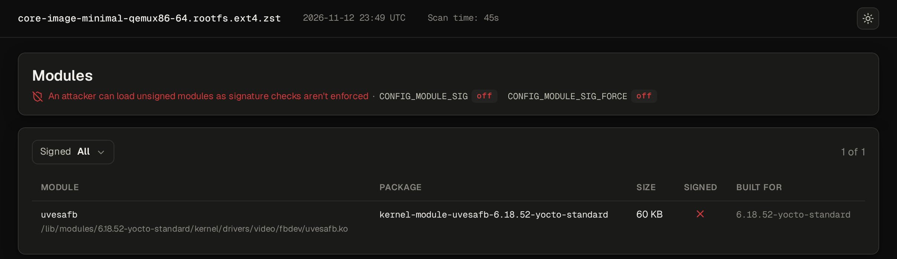
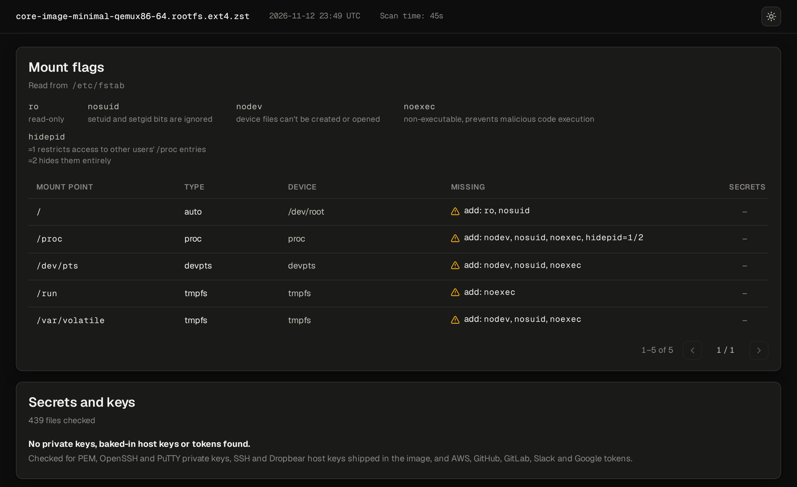

These checks need only the image. Each one has its own page in the dashboard.

## Binaries

Every ELF executable and shared library is checked for compile-time hardening.


| Column | What Trowl looks for |
| --- | --- |
| PIE | The executable is position independent |
| NX | The stack is not executable |
| RELRO | Partial or full read-only relocations |
| Canary | Stack protector symbols |
| FORTIFY | Which of about 30 libc calls use their `_chk` versions |
| IBT/SHSTK, BTI/PAC | CET on x86 or branch protection on arm64 |
| Search path | RPATH or RUNPATH pointing somewhere writable or relative |

Use the uid 0 and setuid filters to find root binaries that lack protections. Stripped static binaries have no symbols to read, so Trowl leaves their canary and FORTIFY cells empty.

## Kernel config

Trowl compares the kernel `.config` with a built-in baseline taken from mainline `kernel/configs/hardening.config` and the KSPP recommendations.


The baseline covers options such as `HARDENED_USERCOPY`, `INIT_ON_ALLOC_DEFAULT_ON`, `SLAB_FREELIST_HARDENED`, `DEFAULT_MMAP_MIN_ADDR` and `MODULE_SIG_FORCE`. It also covers options that should be off, like `PROC_KCORE` and `BINFMT_MISC`. Options newer than your kernel show as not applicable.

Trowl reads the config from `/boot/config-*` or from a kernel image built with `CONFIG_IKCONFIG`. If the image has neither, pass `--kernel-config` or `--kernel-src`.

### Team policy

Some failures are deliberate. Record them in a YAML file and pass it with `--kernel-policy`.

```yaml
accept:
  - option: PROC_KCORE
    reason: "Needed by our crash tooling"
    expires: 2027-01-01   # optional
add:
  - option: DEBUG_FS
    expect: n
    why: "No debugfs in production"
```

Accepted rows show as Accepted with your reason. Once `expires` passes they fail again. Entries under `add` are checked like the built-in ones.

## Kernel modules



Trowl lists every `.ko` under `/lib/modules` and reports whether it is signed. It also shows which SBOM package ships it and whether it was built for the kernel in the image. The page header warns when the kernel doesn't enforce signatures. With `MODULE_SIG_FORCE=y` set, each unsigned module is flagged because the kernel will refuse to load it.

## Mount flags and secrets



Trowl reads `/etc/fstab` and suggests flags for each mount. Writable mounts should have `nodev`, `nosuid` and `noexec`. The root filesystem should be `ro,nosuid`, and `/proc` should use `hidepid`. Mounts made by systemd units or an initramfs are not checked.

The secrets scan looks for:

- PEM, OpenSSH and PuTTY private keys (encrypted or not)
- SSH and Dropbear host keys baked into the image
- AWS, GitHub, GitLab, Slack and Google tokens

The report keeps a short preview and a SHA-256 of each match. The secret itself is never stored.
