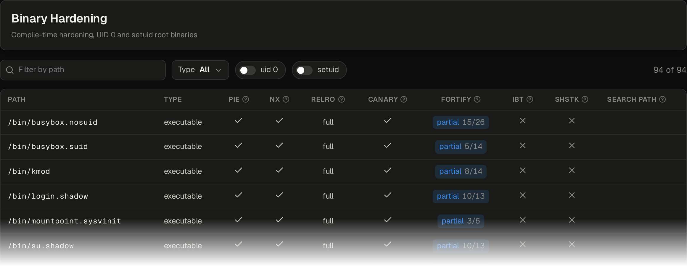

Trowl inspects the built image for missing security protections and sensitive files accidentally left behind. These checks cover:

- Compiler and linker hardening on every executable and shared library.
- Kernel configuration and module signatures.
- Mount flags in `/etc/fstab`.
- Private keys, shared host keys and API tokens.


## Binaries

Trowl reads every ELF executable and shared library in the image and records how it was compiled and linked.



| Check | What it means | Build flag |
| --- | --- | --- |
| `PIE` | The executable is position independent, so ASLR can load it at a random address. | `-fPIE -pie` |
| `NX` | The stack is not executable, so shellcode written to the stack can't run. | `-z noexecstack` |
| `RELRO` | Relocations become read-only after startup. Full RELRO also binds every symbol at load, which locks the GOT. | `-z relro -z now` |
| `Canary` | A guard value before the return address aborts the process when a stack overflow overwrites it. | `-fstack-protector-strong` |
| `FORTIFY` | Calls such as `memcpy` and `sprintf` go through `__*_chk` variants that check the buffer size. | `-O2 -D_FORTIFY_SOURCE=2` |
| `IBT` `SHSTK` | x86 CET. Indirect jumps must land on an `endbr` instruction, and a shadow stack guards return addresses. | `-fcf-protection=full` |
| `BTI` `PAC` | arm64 branch protection. BTI limits indirect branch targets, and PAC signs return addresses. | `-mbranch-protection=standard` |
| `Search path` | An `RPATH` or `RUNPATH` that is relative or points into `/tmp`, `/var/tmp`, `/dev/shm` or `/home`. | Absolute paths or `$ORIGIN` |

FORTIFY shows how many of 33 fortifiable libc functions the binary calls through their checked versions. It is flagged only when none of them are. Canary is judged only for binaries that call those libc functions, so stub libraries and the dynamic loader don't fail.

Libraries are never PIE executables, so their PIE cell is empty. Stripped static binaries have no symbols to read, so Trowl leaves their canary and FORTIFY cells empty too. Use the uid 0 and setuid filters to find root binaries that lack protections.

## Kernel config

Trowl compares the kernel `.config` with a baseline of 22 options taken from the mainline [`hardening.config`](https://github.com/torvalds/linux/blob/master/kernel/configs/hardening.config) and the [KSPP recommended settings](https://kspp.github.io/Recommended_Settings).


Trowl looks for the config in this order:

1. `/boot/config-*` in the image
2. The copy embedded in the kernel image under `/boot`, when it was built with `CONFIG_IKCONFIG`
3. The file passed with `--kernel-config`

:::note
The baseline is growing. More options from both sources are added as each one is reviewed.
:::

### Options that add a protection

| Option | Expected | What it does |
| --- | --- | --- |
| `HARDENED_USERCOPY` | `y` | Bounds-checks copies between kernel and user memory against the real object size. |
| `FORTIFY_SOURCE` | `y` | Adds compile-time and run-time bounds checks to kernel string and memory functions. |
| `LIST_HARDENED` | `y` | Checks linked-list pointers for corruption before following them. |
| `INIT_ON_ALLOC_DEFAULT_ON` | `y` | Zeroes heap and page allocations, so stale data can't leak through new objects. |
| `INIT_ON_FREE_DEFAULT_ON` | `y` | Wipes memory on free, which narrows use-after-free and info-leak windows. |
| `INIT_STACK_ALL_ZERO` | `y` | Zero-initialises stack variables. Needs compiler support. |
| `KSTACK_ERASE` | `y` | Clears the kernel stack before returning to user space. |
| `SLAB_FREELIST_RANDOM` | `y` | Randomises the slab freelist order, so heap layout is harder to predict. |
| `SLAB_FREELIST_HARDENED` | `y` | Obfuscates freelist pointers and checks them for corruption. |
| `SLAB_BUCKETS` | `y` | Keeps user-controlled allocations apart from other kmalloc caches. |
| `RANDOM_KMALLOC_CACHES` | `y` | Spreads kmalloc allocations over several caches to defeat heap spraying. |
| `SHUFFLE_PAGE_ALLOCATOR` | `y` | Randomises the page allocator's free lists. |
| `DEFAULT_MMAP_MIN_ADDR` | `≥ 65536` | Keeps low addresses unmappable, so NULL-pointer dereferences can't be exploited. The arm and arm64 minimum is `32768`. |
| `SECURITY_DMESG_RESTRICT` | `y` | Hides the kernel log, and the kernel addresses in it, from unprivileged users. |
| `SECURITY_YAMA` | `y` | Restricts `ptrace` to a process's own descendants. |
| `MODULE_SIG` | `y` | Checks the signature of every module the kernel loads. |
| `MODULE_SIG_FORCE` | `y` | Refuses to load modules without a valid signature. |
| `SYN_COOKIES` | `y` | Keeps TCP accepting connections during a SYN flood. |

### Options that expose attack surface

| Option | Expected | What it exposes |
| --- | --- | --- |
| `PROC_KCORE` | `n` | `/proc/kcore`, which maps kernel memory as an ELF core file. |
| `BINFMT_MISC` | `n` | User-registered interpreters that run arbitrary file formats. |
| `COMPAT_BRK` | `n` | Turns off heap randomisation for old binaries. |
| `USERFAULTFD` | `n` | Lets unprivileged code stall page faults, a common aid in kernel race exploits. CRIU and live migration need it. |

### Results

| Result | Meaning |
| --- | --- |
| `Pass` | The option has the expected value. |
| `Fail` | The value differs. An option built as a module (`m`) where `y` is expected fails with a note. |
| `Missing` | The option isn't in the config at all. Its dependencies are off or the compiler lacks support. |
| `Not applicable` | The option is newer than the kernel in the image. |
| `Accepted` | Your team policy accepts the failure. |

### Team policy

Some failures are deliberate. Record them in a YAML file and pass it with `--kernel-policy`.

```yaml
accept:
  - option: PROC_KCORE
    reason: "Needed by our crash tooling"
    expires: 2027-01-01   # optional
add:
  - option: DEBUG_FS
    expect: n
    why: "No debugfs in production"
```

Every entry under `accept` needs a `reason`, which the report shows next to the row. Once `expires` passes, the row fails again. Entries under `add` are checked like the built-in ones and take the same fields.

## Kernel modules


Trowl lists every module under `/lib/modules`, including compressed `.ko.xz`, `.ko.gz` and `.ko.zst` files. For each one it reports:

| Field | What Trowl reads |
| --- | --- |
| `Signed` | Whether a module signature is appended to the file. |
| `Vermagic` | Whether the module was built for the kernel version in the image. |
| `License` | The license string from the module's `modinfo`. |
| `Package` | The SBOM package that ships the module. |

The page header shows how the kernel treats signatures. `MODULE_SIG_FORCE=y` means enforced, and every unsigned module is flagged because the kernel will refuse to load it. `MODULE_SIG=y` alone means checked, so unsigned modules still load. Without either, signing is off.

## Mount flags


Trowl reads `/etc/fstab` and lists the flags each mount is missing.

| Flag | What it does |
| --- | --- |
| `ro` | Mounts the filesystem read-only. |
| `nosuid` | Ignores setuid and setgid bits, so no binary on the mount can raise privileges. |
| `nodev` | Stops device files on the mount from being opened. |
| `noexec` | Stops binaries on the mount from being executed. |
| `hidepid` | `1` hides other users' `/proc` entries, and `2` hides their PIDs entirely. |

Which flags a mount needs depends on what it is:

| Mount | Required flags |
| --- | --- |
| Root filesystem `/` | `ro` `nosuid` |
| Any read-write mount | `nodev` `nosuid` `noexec` |
| `proc` | `hidepid` set to anything but `0` or `off`, on top of the above |

Read-only mounts other than `/` need no flags. Swap entries are skipped. An image with no `/etc/fstab` gets a finding, because its mounts can't be assessed. Mounts created by systemd `.mount` units or an initramfs are not checked yet.

## Secrets

Trowl scans every file up to 4 MiB for credentials. ELF binaries are skipped.

| Finding | What Trowl matches |
| --- | --- |
| Private keys | PEM keys (RSA, EC, DSA, Ed25519, PKCS#8), OpenSSH and PuTTY keys. Each is marked encrypted or unencrypted. |
| Baked host keys | `/etc/ssh/ssh_host_*_key` and `/etc/dropbear/dropbear_*_host_key`. Every device flashed with the image shares that identity. |
| Cloud and SaaS tokens | AWS access key IDs, GitHub, GitLab and Slack tokens, and Google API keys. |
| Keys in JSON | A `"private_key"` field holding a PEM key, as in cloud service account files. |

The report keeps the first six characters and a SHA-256 of each match. The secret itself is never stored, and the hash lets you find the same secret across images.
