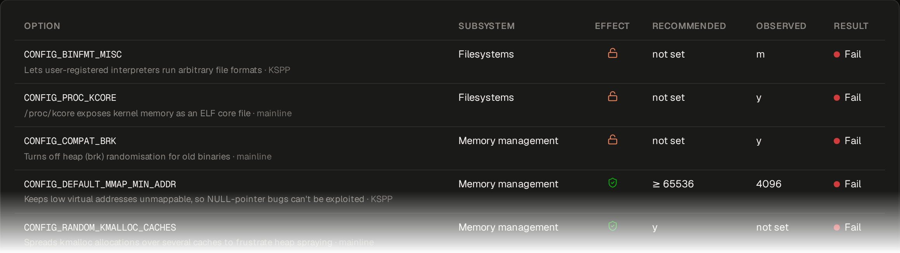
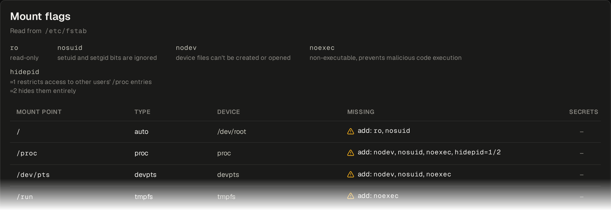

Trowl inspects the built image for missing security protections and sensitive files accidentally left behind. These checks cover:

- Compiler and linker hardening on every executable and shared library.
- Kernel configuration and module signatures.
- Mount flags in `/etc/fstab`.
- Private keys, shared host keys and API tokens.


## Binaries

Trowl reads every ELF executable and shared library in the image and records how it was compiled and linked.


| Check | What it means |
| --- | --- |
| `PIE` | The executable is position independent, so ASLR can load it at a random address. |
| `NX` | The stack is not executable, so shellcode written to the stack can't run. |
| `RELRO` | Relocations become read-only after startup. Full RELRO also binds every symbol at load, which locks the GOT. |
| `Canary` | A guard value before the return address aborts the process when a stack overflow overwrites it. |
| `FORTIFY` | Calls such as `memcpy` and `sprintf` go through `__*_chk` variants that check the buffer size. |
| `IBT` `SHSTK` | x86 CET. Indirect jumps must land on an `endbr` instruction, and a shadow stack guards return addresses. |
| `BTI` `PAC` | arm64 branch protection. BTI limits indirect branch targets, and PAC signs return addresses. |
| `Search path` | An `RPATH` or `RUNPATH` that is relative or points into `/tmp`, `/var/tmp`, `/dev/shm` or `/home`. |

FORTIFY counts supported libc functions with checked variants. Trowl flags it when the binary uses those functions without any checked variants. Missing canaries are flagged only for binaries that use buffer-handling libc functions.

PIE applies only to executables. Trowl leaves canary and FORTIFY blank when a binary has no symbols to inspect. Use the `uid 0` and `setuid` filters to focus on privileged executables.

## Kernel config

Trowl checks the kernel hardening state against [139 baseline](https://github.com/corefense-security/trowl/tree/main/internal/checks/kconfig/baseline) options, drawn from [mainline](https://github.com/torvalds/linux/blob/master/kernel/configs/hardening.config) and the [KSPP recommendations](https://kspp.github.io/Recommended_Settings).



Trowl looks for the config in this order:

1. `/boot/config-*` in the image
2. The copy embedded in the kernel image under `/boot`, when it was built with `CONFIG_IKCONFIG`
3. The file passed with `--kernel-config`

### Results

| Result | Meaning |
| --- | --- |
| `Pass` | The option has the expected value. |
| `Fail` | The value differs. An option built as a module (`m`) where `y` is expected fails with a note. |
| `Missing` | The option isn't in the config at all. Its dependencies are off or the compiler lacks support. |
| `Not applicable` | The option is newer than the kernel in the image. |
| `Accepted` | Your team policy accepts the failure. |

### Team policy

Teams can add kernel configuration checks and record accepted failures in a YAML policy file passed with `--kernel-policy`. Trowl reports its built-in checks alongside the team's additions.

```yaml
accept:
  - option: PROC_KCORE
    reason: "Needed by our crash tooling"
    expires: 2027-01-01   # optional
add:
  - option: DEBUG_FS
    expect: n
    why: "No debugfs in production"
```

Every entry under `accept` needs a `reason`, which the report shows next to the row. Once `expires` passes, the row fails again. Entries under `add` are checked like the built-in ones and take the same fields.

## Kernel modules


Trowl lists every module under `/lib/modules`, including compressed `.ko.xz`, `.ko.gz` and `.ko.zst` files. For each one it reports:

| Field | What Trowl reads |
| --- | --- |
| `Module` | Module name and path, plus signature type (such as PKCS#7) and length when present. |
| `Package` | The SBOM package that ships the module. |
| `Size` | Module file size and whether it is compressed. |
| `Signed` | Whether signature metadata is appended (checks the 28-byte `~Module signature appended~\n` end marker and preceding 12-byte trailer after decompression; does not verify the signature). |
| `Built for` | Kernel version from `vermagic`, with a warning if it differs from the image's kernel. |

## Mount flags



Trowl reads `/etc/fstab` and lists the flags each mount is missing.

| Flag | What it does |
| --- | --- |
| `ro` | Mounts the filesystem read-only. |
| `nosuid` | Ignores setuid and setgid bits, so no binary on the mount can raise privileges. |
| `nodev` | Stops device files on the mount from being opened. |
| `noexec` | Stops binaries on the mount from being executed. |
| `hidepid` | `1` hides other users' `/proc` entries, and `2` hides their PIDs entirely. |

Which flags a mount needs depends on what it is:

| Mount | Required flags |
| --- | --- |
| Root filesystem `/` | `ro` `nosuid` |
| Any read-write mount | `nodev` `nosuid` `noexec` |
| `proc` | `hidepid` set to anything but `0` or `off`, on top of the above |

Read-only mounts other than `/` need no extra flags except the `proc` protections above. Swap entries are skipped.

If `/etc/fstab` is absent, Trowl reports `fstab.missing` to indicate that mount checks could not run.

:::note:::
Mounts created by systemd `.mount` units or an initramfs are not checked yet.
:::

## Secrets

Trowl scans every file up to **4 MiB** for credentials. ELF binaries are skipped.

| Finding | What Trowl matches |
| --- | --- |
| Private keys | PEM keys (RSA, EC, DSA, Ed25519, PKCS#8), OpenSSH and PuTTY keys. Each is marked encrypted or unencrypted. |
| Baked host keys | `/etc/ssh/ssh_host_*_key` and `/etc/dropbear/dropbear_*_host_key`. Every device flashed with the image shares that identity. |
| Cloud and SaaS tokens | AWS access key IDs, GitHub, GitLab and Slack tokens, and Google API keys. |
| Keys in JSON | A `"private_key"` field holding a PEM key, as in cloud service account files. |

The report stores a `SHA-256` hash of each secret it reads, so the same secret can be identified across images. Secret values are never stored in the report.
