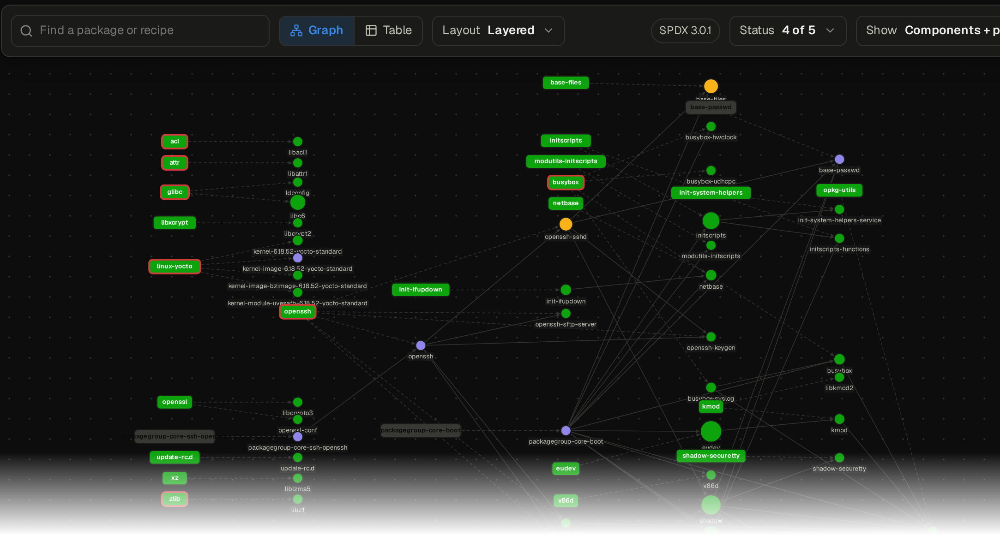
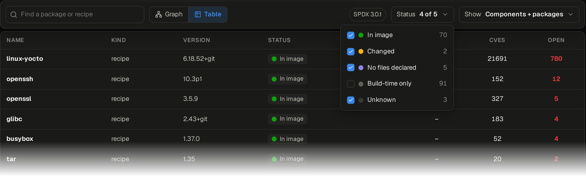
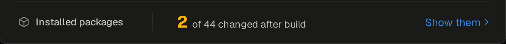

Pass `--sbom` for SBOM analysis. Trowl draws the dependency graph, checks every package against the files in the image, and reads the component list for [CVE analysis](../cves-vex).

## Supported formats

| Format | Accepted as |
| --- | --- |
| `SPDX 3.0` | One JSON-LD file |
| `SPDX 2.2` | `IMAGE.spdx.tar.zst`, a plain tar, a directory of documents or one JSON file |
| `CycloneDX` | One JSON file, plus an optional VEX file |

:::note
SPDX 2.3 and CycloneDX XML are not currently supported
:::

## How Trowl reads each format

Each reader follows the layout produced by the build tools it was tested with. SBOMs from other tools also load, but missing fields may limit the detail Trowl can show.

### SPDX 3.0

Tested with Yocto Wrynose (`create-spdx-3.0`), which writes one JSON-LD graph for the image. VEX comes from recipes patched or marked in `CVE_STATUS` , and `sbom-cve-check`.

| Element | Trowl uses it for |
| --- | --- |
| `software_Package` | Recipes and binary packages with their CPE and PURL. Yocto's `/recipe/` and `/package/` ids set the role, otherwise `software_primaryPurpose` and `generates` |
| `software_File` | File paths and SHA-256 for the presence check |
| `generates` `dependsOn` | Recipe-to-package edges, and runtime or build dependencies by scope |
| `security_Vulnerability` | The CVEs the SBOM lists for each component |
| `security_Vex*VulnAssessmentRelationship` | The `Fixed`, `NotAffected`, `Affected` and `UnderInvestigation` types become statuses, and `security_statusNotes` their notes. A "fixed in" or "backported in" version fills the Fixed in column |
| `security_CvssV*VulnAssessmentRelationship` | The highest v2, v3 and v4 score per CVE |

Each VEX relationship type gets mapped to a Trowl status in the report.

| SBOM status | Trowl status |
| --- | --- |
| `security_VexFixedVulnAssessmentRelationship` | Fixed |
| `security_VexNotAffectedVulnAssessmentRelationship` | Not affected |
| `security_VexAffectedVulnAssessmentRelationship` | Affected |
| `security_VexUnderInvestigationVulnAssessmentRelationship` | Under investigation |

:::note
A `security_Vulnerability` with no VEX relationship gets Unknown, or Affected (when version in range).
:::

### SPDX 2.2
Tested with Yocto Scarthgap (`create-spdx-2.2`), which writes a document for each recipe and package, bundled as `IMAGE.spdx.tar.zst`.

These documents only list fixed CVEs. Trowl finds the others through version matching.

| Element | Trowl uses it for |
| --- | --- |
| `packages` | Recipes, images and binary packages with their CPE and PURL. Yocto's `SPDXRef-Recipe-` and `SPDXRef-Image-` ids set the role, and packages from other tools count as binary packages |
| `files` | File paths and SHA-256 for the presence check |
| `GENERATED_FROM` | Recipe-to-package edges |
| `RUNTIME_DEPENDENCY_OF` `DEPENDS_ON` | Runtime dependencies between packages |
| `BUILD_DEPENDENCY_OF` | Build dependencies between recipes |
| `sourceInfo` | The recipe's `CVEs fixed:` list, which becomes Fixed |

SPDX 2.2 has no VEX, so the patched list is the only status Trowl takes from it.

| SBOM status | Trowl status |
| --- | --- |
| `CVEs fixed:` in the recipe's `sourceInfo` | Fixed |

Userland CVEs found by version match are marked as Affected, while kernel CVEs get VEX with `--kernel-tree`.

### CycloneDX

Tested with Buildroot (`make generate-cyclonedx`) and Yocto's `meta-cyclonedx` which writes separate SBOM and VEX files. 

Neither tool lists files under its components, so Trowl skips presence checks for these SBOMs.

| Element | Trowl uses it for | Generated by |
| --- | --- | --- |
| `components` | One component per package with its CPE and PURL | Both |
| `scope: excluded` | Marks the component Build-time only | Buildroot (host tools) |
| `dependencies` | Edges between components | Both |
| `pedigree.patches` | CVEs a patch resolves, which become Fixed | Buildroot |
| `vulnerabilities` | CVE statuses from each `analysis.state`. A GHSA entry uses its first CVE reference | Buildroot in the SBOM, Yocto in its VEX file |
| `type: file` components nested in a component | File paths and SHA-256 for the presence check | Other tools |

Trowl maps each `analysis.state` whether it comes from the SBOM or a separate VEX file.

| SBOM status | Trowl status |
| --- | --- |
| `resolved` `resolved_with_pedigree` | Fixed |
| `not_affected` `false_positive` | Not affected |
| `exploitable` | Affected |
| `in_triage` | Under investigation |

:::note
A `vulnerabilities` entry with no `analysis` gets Unknown, or Affected when (version in range).
:::

#### Separate VEX files

Pass separate CycloneDX JSON VEX files (e.g. Yocto's `meta-cyclonedx`) via `--vex`. Like any [VEX file](../cves-vex/#vex-files), its statuses override the SBOM's and Trowl's kernel verdicts.

`meta-cyclonedx` writes the build's cve-check results to this file. Add `--override` so Trowl's kernel check can still clear kernel CVEs whose code isn't built.

```sh
trowl scan image.rootfs.ext4 --sbom bom.json --vex vex.json --kernel-tree linux --override -o report
```

##### SBOM linking

A VEX file names components by BOM-Link, so Trowl needs the SBOM's `serialNumber` and `version` to resolve them. Each `affects` ref takes the form `urn:cdx:<serial>/<version>#<bom-ref>`.

```json title="bom.json"
"serialNumber": "urn:uuid:1111…5555",
"version": 1,
"components": [{ "bom-ref": "openssl", "name": "openssl", "version": "3.5.4" }]
```

```json title="vex.json"
{
  "id": "CVE-2025-1001",
  "analysis": { "state": "resolved", "detail": "Fixed from version 3.5.4" },
  "affects": [{ "ref": "urn:cdx:1111…5555/1#openssl" }]
}
```

The `analysis.state` maps to a Trowl `Fixed` status through the table above, and `justification` and `detail` become the status notes.

##### Skipped and refused statements

Trowl skips a ref that points at another serial or version, or at a `bom-ref` the SBOM doesn't list. The scan log counts them as "skipped for another BOM or component".

**Trowl refuses the whole file when:**

- the SBOM has no `serialNumber`
- a statement has no `id`, no `affects` or no `analysis`
- an `analysis.state` is missing or isn't a CycloneDX state
- no statement reaches this SBOM, which means the VEX belongs to another build

##### Precedence

A CycloneDX SBOM can carry its own `vulnerabilities`, so the SBOM and the VEX file may both state a status for the same CVE on the same component. Trowl reads the SBOM first and then applies the VEX file, so the VEX status wins.

This follows how the two files are used. The SBOM is fixed when the image is built. The VEX file is where CVE analysis is recorded, and it can be updated after triage without rebuilding the image. When the two disagree, the VEX file is the more recent statement.

A VEX statement for a CVE the SBOM doesn't list adds that CVE to the component with the VEX status.

## Dependency graph

The toolbar shows the detected format and lets you choose a Layered, Radial or Force layout. Show selects components, packages or both. Status hides selected presence states. Large SBOMs initially show components to keep the graph readable.

Switch to **Table** view for the same nodes and relationships if the graph is too dense.



What the graph shows depends on the format:

| Format | Nodes | Edges |
| --- | --- | --- |
| `SPDX 3.0` `SPDX 2.2` | Recipes as pills and binary packages as circles sized by file count | Dashed lines from each recipe to the packages it builds. Solid lines for runtime dependencies. |
| `CycloneDX` | One node per component, since there are no recipes | The `dependencies` list |

**Table** lists the same nodes, relationships and metadata. Use it when the graph is too dense.

## Packages against files

Trowl checks each package’s declared files against the image by path and SHA-256. The results appear in the SBOM Analysis table’s Status column and as fill colours in the graph.



| Status | Meaning |
| --- | --- |
| `In image` | Every declared file is present, or its hash matches. |
| `Changed` | Every file is present, but their hashes don't match. |
| `Partial` | Some declared files are missing. |
| `Not in image` | None of the declared files are present. |
| `No files declared` | The SBOM lists no files for the package, so there is nothing to compare. |
| `Build-time only` | A recipe with no output packages, or a CycloneDX component scoped `excluded`. |
| `Unknown` | A recipe whose packages can't be judged either way. |

A recipe counts as shipping when any of its packages is In image, Changed or Partial. Symlinks count as present. Packages whose files all sit under `/boot` aren't marked missing when the image has other partitions, because the boot partition may simply not be in the scanned image.

The dashboard's **Overview** section shows how many packages changed or lost files.



If the SBOM declares no files, as with Buildroot, the row reports that presence checks were skipped.

## SBOM for CVE analysis

Trowl uses the SBOM's CVE information and VEX statuses, then adds its own findings with supporting evidence.

### What Trowl adds

- **CVE matching.** Trowl matches CVEs to the SBOM's recipes, or to its packages if there are no recipes. See [Matching](../cves-vex/#matching).
- **Additional CVEs.** Version matching finds CVEs the SBOM doesn't list, often published after the build. A <code class="mark">*</code> after the CVE ID marks these findings.
- **Statuses for CVEs the SBOM leaves blank.** When the SBOM lists a CVE without a status and its version is in range, Trowl marks it Affected without the <code class="mark">*</code>. The detail panel shows Unknown from the SBOM under Trowl's Affected.
- **Shipping status.** Presence checks set the Shipped column. Affected CVEs on packages that don't ship are counted separately.
- **Kernel verdicts.** With `--kernel-tree`, Trowl re-checks the SBOM's kernel CVE statuses against the config. A differing verdict adds a yellow <code class="mark warn">≠</code> to the status and includes the CVE in the [Disagreements](../cves-vex/#disagreements) filter.
- **Name-only matches.** If the SBOM's CPE has no vendor, the match relies on the product name alone and may refer to another project. The CVE ID appears in yellow, like <code class="warn">CVE-2026-12345</code>.
- **Kernel version.** The scan stops if the SBOM's kernel release doesn't match `/lib/modules` in the image. The SBOM probably belongs to a different build.

### What Trowl leaves alone

- **Userland statuses.** Trowl keeps the SBOM's Fixed and Not affected statuses, even for packages that don't ship. Only kernel CVEs receive a [VEX verdict](../cves-vex/#vex-assessment) from Trowl.
- **Fixed kernel CVEs.** Kernel checks never override Fixed.
- **PURLs.** Trowl reads and displays them, but uses CPEs for matching.
- **Unlisted files.** Trowl doesn't list image files that no SBOM package declares. Code vendored into another package isn't visible either.
