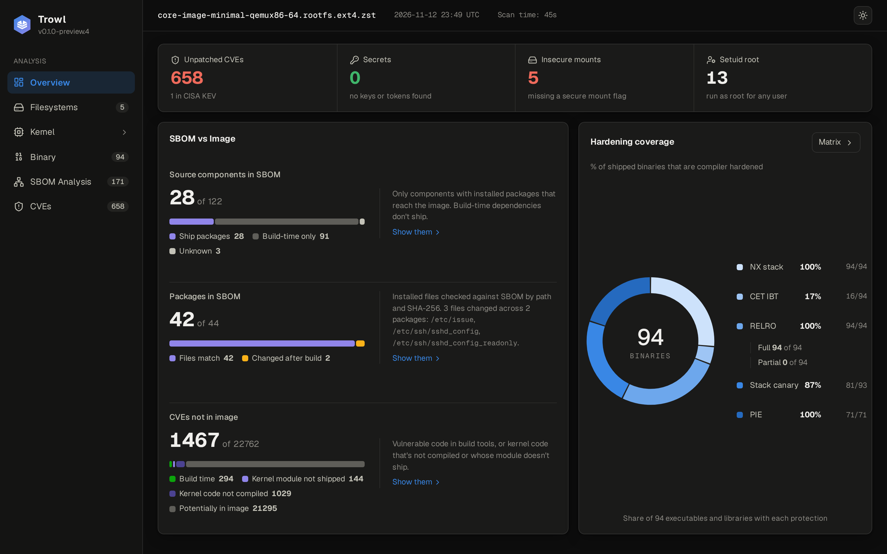

A Yocto SBOM lists every recipe that took part in the build. Most of them never reach the image. Trowl reads the image to find which ones do.

```sh
trowl scan image.rootfs.ext4 --sbom image.rootfs.spdx.json -o report
```

## Packages against files

For each binary package, Trowl looks up every file the SBOM declares in the image and compares its SHA-256.

| Status | Meaning |
| --- | --- |
| In image | All files are present and match |
| Changed | Files are present but were edited after the build |
| Partial | Some files are missing |
| Not in image | None of the files are present |
| Build-time only | Compilers, native tools and other recipes that ship nothing |

The Overview sums this up. In the scan below only 28 of 122 recipes ship anything. Two packages changed after the build (`/etc/issue` and the SSH config).



CVEs on recipes that don't ship are grouped as candidates for VEX `not_affected` with `component_not_present`.

## Dependency graph

The SBOM Analysis page draws recipes, the packages they build and the runtime dependencies between packages. Red outlines mark components with open CVEs. Click a node to see its files, dependencies and CVEs.


Large SBOMs start at component level. Switch to Table for a sortable list.

## Limits

- The check is per package. Files in the image that no SBOM package declares are not reported.
- Code that is statically linked or vendored into another package is not visible.
- If the kernel version in the SBOM doesn't match `/lib/modules` in the image, Trowl stops. The SBOM probably belongs to a different build.

[Supported targets](../../reference/supported-targets/) lists the accepted formats.
