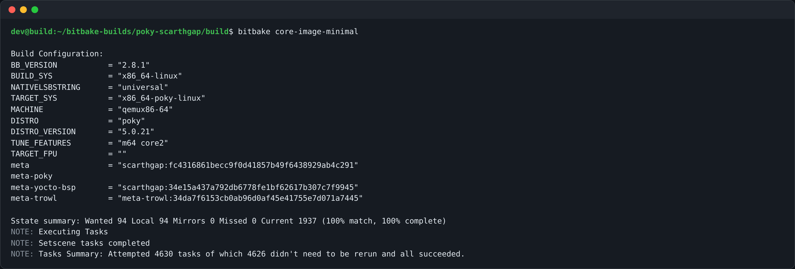
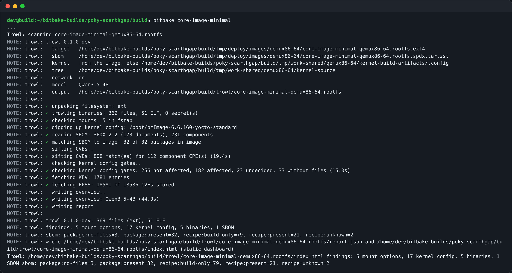

import { Steps } from '@astrojs/starlight/components';

The meta-trowl layer scans each image after BitBake builds it. It finds the image, the SBOM and the kernel inputs on its own, so you don't pass any paths. It is tested on Scarthgap (5.0) and Wrynose with `core-image-minimal` for `qemux86-64`.

## Add the layer

<Steps>

1. Clone Trowl next to your other layers. The layer is in `integrations/meta-trowl`.

   ```sh
   git clone https://github.com/corefense-security/trowl.git
   ```

2. From your build directory, add the layer and turn the scan on.

   ```sh
   bitbake-layers add-layer /path/to/trowl/integrations/meta-trowl
   echo 'INHERIT += "trowl"' >> conf/local.conf
   ```

3. Build the image as usual.

   ```sh
   bitbake core-image-minimal
   ```

</Steps>

The one `bitbake` builds Trowl, builds the image and then scans it. Adding the layer without `INHERIT += "trowl"` changes nothing.



When the build finishes, the scan output follows the task summary. The last line points to the report.



Open that `index.html` in your browser. The report folder is self-contained, so you can also publish it as a CI artifact or on any static host.

## What it changes in your build

Nothing. Trowl is a post-build scanner and the layer keeps it that way.

- No task is added to the image and its signatures, sstate and output stay the same.
- The scan runs after the build succeeds. A failed build isn't scanned.
- Reports go to `trowl/<image>/` in the build directory. Nothing is written into `TMPDIR`.
- An image is scanned again only when it is newer than its report.

## Where the inputs come from

Every image build writes `<image>.testdata.json` to the deploy folder. The layer reads it for each image on the `bitbake` command line.

| Input | Taken from | When it is missing |
| --- | --- | --- |
| Image | `IMAGE_LINK_NAME` and the first of `TROWL_FSTYPES` in `IMAGE_FSTYPES` | Warning, and the image isn't scanned |
| SBOM | `.sbom-cve-check.spdx.json`, then `.spdx.json` (SPDX 3.0), then `.spdx.tar.zst` (SPDX 2.2) | Warning, and only the image is scanned |
| Kernel config | `.config` in `STAGING_KERNEL_BUILDDIR` | Warning, and Trowl uses a config the image carries if any |
| Kernel source | `STAGING_KERNEL_DIR` | Warning, and kernel CVEs stay version matches |

Scarthgap writes SPDX 2.2 by default and Wrynose writes SPDX 3.0. With the `core/yocto/sbom-cve-check` fragment Wrynose also writes the `sbom-cve-check` SBOM, which the layer prefers.

The kernel config and source exist only when the kernel was built in this `TMPDIR`. If the kernel came from sstate, the scan runs without them.

## Settings

Set these in `local.conf`.

| Variable | Default | Meaning |
| --- | --- | --- |
| `TROWL_SCAN` | `1` | `0` turns the scan off |
| `TROWL_REPORT_DIR` | `${TOPDIR}/trowl` | Where reports go, one folder per image |
| `TROWL_ALWAYS` | `0` | `1` scans after every build, not only when the image changed |
| `TROWL_FSTYPES` | ext4, squashfs, tar, cpio and wic variants | Image types the layer looks for, in order |
| `TROWL_SBOM_NAMES` | see above | SBOM names the layer looks for, in order |
| `TROWL_EXTRA_ARGS` | empty | More `trowl scan` flags |
| `TROWL_LLM` | `0` | `1` adds the Overview summary |
| `TROWL_LLM_MODEL` | `qwen3.5-4b` | `qwen3-4b`, `qwen3.5-4b` or `qwen3.5-9b` |

## The Overview summary

The summary is off by default because the model is a 2.7 GB download. To turn it on, add this to `local.conf`.

```sh
TROWL_LLM = "1"
```

The next `bitbake` also builds `llama-server` from llama.cpp and fetches the model into `DL_DIR`, where it is checked against its SHA-256. Both are shared through sstate and `DL_DIR` like any other recipe.

## Offline builds

With `BB_NO_NETWORK = "1"` the scan runs offline. It then needs the CVE feeds in `~/.cache/trowl` from an earlier scan with network access. See [Network and cache](../../reference/network-cache/).

## How Trowl is built

The layer builds Trowl from the checkout it sits in, so you always get the Trowl version the layer came with. Go and Node are pinned in the recipe because Scarthgap ships an older Go and neither release ships Node. Go modules and npm packages are fetched as plain downloads and checked against `go.sum` and `package-lock.json`.

## Known issue on Wrynose

With `rm_work` and the `sbom-cve-check` fragment, Wrynose's own `do_sbom_cve_check` fails on a rebuild. This happens with or without the layer, and since the build fails, Trowl doesn't scan. Clean the image to get a working build again.

```sh
bitbake -c cleansstate core-image-minimal
```
